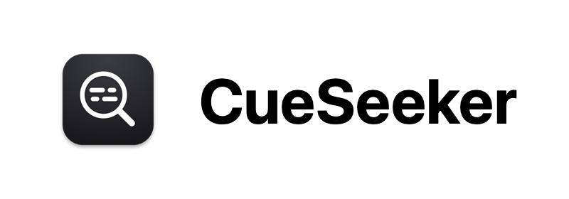

<p align="center">
  
</p>

<p align="center">
  English | <a href="README.zh-Hans.md">简体中文</a> | <a href="README.zh-Hant.md">繁體中文</a>
</p>

## Overview

CueSeeker is a language learning tool centered around subtitle search, excerpt, and queue playback, complemented by practical features such as Anki card export, deep links, and collage.

## Build Guide

### Requirements

- **Operating System**: macOS 13 (Ventura) or later.
- **Architecture**: Apple Silicon only (M-series chips); Intel (x86_64) is not supported.
- **Developer Tools**: Xcode 16+ or Xcode Command Line Tools.
- **Dependencies**: System-provided `python3` on macOS (the build script only creates a temporary internal virtual environment to drive Meson/Ninja, without polluting the global environment).

### Build & Run

#### 1. Prerequisites

Before building, install the Apple Command Line Tools (skip if already installed):

```bash
xcode-select --install
```

#### 2. Build Media Runtime (First-time only)

CueSeeker relies on a dedicated self-contained media runtime (integrating FFmpeg, libass, and necessary patches). Run the build script once from the project root:

```bash
./scripts/build_macos_media_runtime.sh
```

#### 3. Local Development & Launch

Navigate to the native app directory and launch directly via SwiftPM:

```bash
cd apps/macos-native
swift run CueSeeker
```

#### 4. Package Standalone App

To package a standalone release app (`.app`), run the packaging script from the project root:

```bash
./scripts/package_macos_app.sh
```

The packaged app will be located at `.build/distribution/CueSeeker.app`.

## Acknowledgments

- **Fansub & Game Fan-Translation Groups**: It is thanks to everyone's dedication and passion that this project was made possible and continues to be meaningful to maintain.
- **Bilibili *It's MyGO!!!!!* & *Ave Mujica* Fan Creator Community**: I love *It's MyGO!!!!!*, and I love all of you.
- ***Metaphor: ReFantazio***: Thank you for the wonderful memories—my heart still lingers in that autumn of 2024.
- **My Family**: For the endless encouragement and support throughout this development journey.

## Third-Party Dependencies

CueSeeker's runtime and visual presentation rely on the following open-source projects:

### Media & Audio/Video Processing

Underlying media demuxing, fallback software decoding, and subtitle rendering are built on a custom compiled dynamic library chain (GPL/Nonfree components completely disabled, adhering to LGPL / BSD licenses):

- **[FFmpeg](https://ffmpeg.org/) (8.1.2)**: Audio/video demuxing and decoding core (LGPL v2.1+).
- **[libass](https://github.com/libass/libass) (0.17.4)**: Native ASS-style subtitle rendering engine (ISC).
- **[dav1d](https://code.videolan.org/videolan/dav1d) (1.5.4)**: AV1 video cover extraction software decoder (BSD-2-Clause).
- **[LAME](https://lame.sourceforge.io/) (3.100)**: MP3 audio encoder for Anki export (LGPL v2.0+).
- **[FreeType](https://freetype.org/)** / **[HarfBuzz](https://harfbuzz.github.io/)** / **[FriBidi](https://github.com/fribidi/fribidi)** / **[libunibreak](https://github.com/adah1972/libunibreak)**: Dependencies for font rasterization, text shaping, bidirectional layout, and line breaking.

### UI & Visual Assets

- **[Phosphor Icons](https://phosphoricons.com/)**: Application UI icons originate from the Phosphor vector icon library originals (MIT License), bundled inside the application resources.

## License

This project is licensed under the **[MIT License](LICENSE)**.

Third-party media libraries in the distributed package retain their respective open-source licenses (LGPL, BSD, ISC, etc.). For complete third-party license texts, please refer to the `CueSeeker.app/Contents/Resources/ThirdPartyLicenses/` directory inside the application bundle.