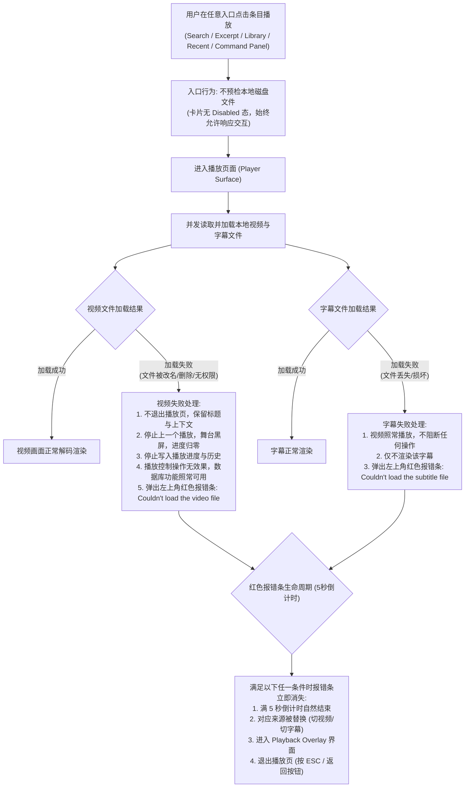
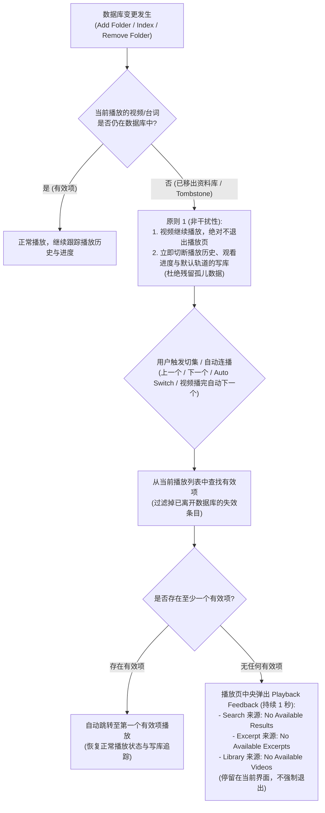
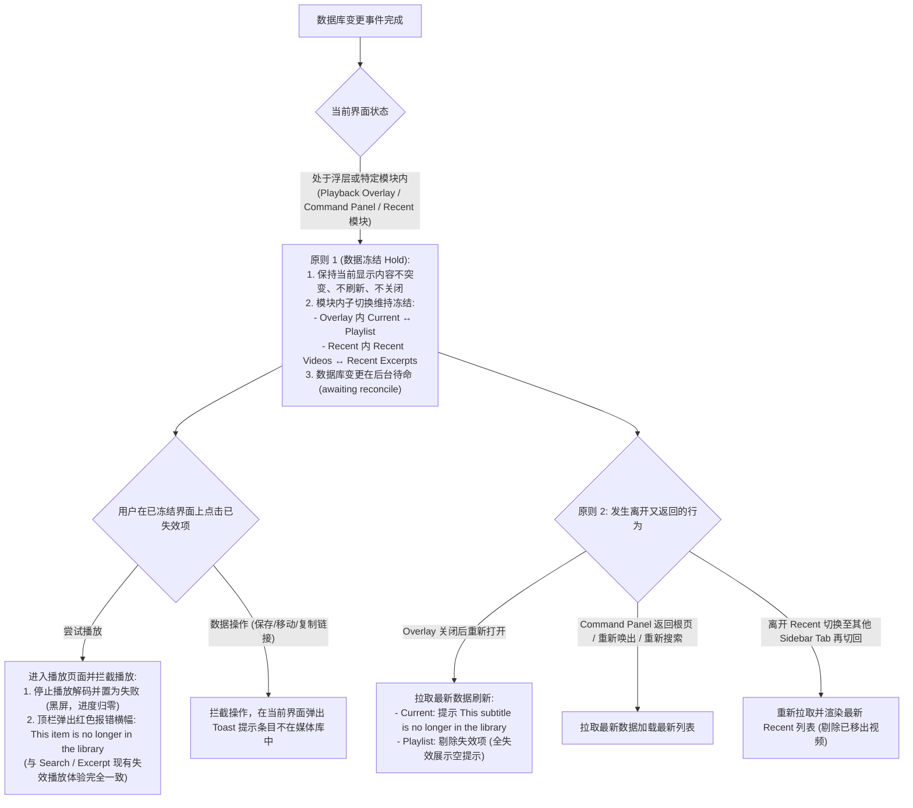
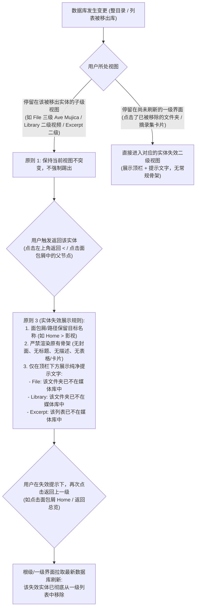

# 说明

1. 本文档由人类维护，定义播放与工作台各界面在「本地物理文件缺失」以及「资料库变更导致内容失效」下的持久化设计与交互规则。

# 核心设计原则

## 1. 原则 1（非干扰性原则 / Non-disruption）
- **播放中移出资料库**：库变更发生时，若当前正在播放的条目被移出数据库，**继续播放、绝对不退出播放页**；立即切断向数据库写入该视频的播放进度、历史记录与默认轨道（杜绝孤儿数据）。
- **已展示界面数据冻结（Hold）**：库变更发生时，当前用户停留的界面、已打开的浮层（Playback Overlay、Command Panel、Search、Recent 模块、Library 二级、File 二级与子级视图、Excerpt 二级）**保持原内容不突变、不强制关闭、不闪烁刷新**（唯一例外：File 一级根目录作为文件夹管理入口，发生增删变更时即时刷新）。
- **内部标签切换不离开**：在同一个模块内部切换视图（如 Playback Overlay 内的 Current ↔ Playlist；Recent 内的 Recent Videos ↔ Recent Excerpt Lists），**维持冻结状态，不触发刷新**。

## 2. 原则 2（边界刷新与失效拦截原则 / Boundary Reconciliation）
- **离开又返回触发刷新**：关闭再打开浮层、面包屑回退、从二级返回一级、跨 Sidebar Tab 切换再切回、重新搜索等越界行为，**一律拉取最新数据库状态更新界面**。其中 Search 再次进入时，若期间仅发生过移除文件夹则只剔除失效结果，若发生过 Index 或 Add Folder 则按当前搜索词与已选 Filter 重新搜索。
- **未刷新前的失效拦截**：在尚未刷新的冻结界面上点击已移出库的失效项，**严格拦截核心操作**：
  - **尝试播放**：统一进入播放页面并拦截播放（黑屏、进度归零），顶栏弹出红色报错横幅 `This item is no longer in the library`（与现有的 Search、Excerpt 失效播放行为完全一致）。
  - **数据操作**（保存/移动/复制深链接等）：严格拦截操作，在当前工作区弹出对应 Toast 提示。

## 3. 原则 3（父子层级回退与实体失效展示规则）
- 当某个父级文件夹或摘录集被移出库，用户处于其子级视图并**触发返回该父级**时（例如 File 三级回退到二级文件夹，或处于已移出库的 Library / Excerpt 二级）：
  - **保留路径上下文**：面包屑或顶部导航**保留目标路径名称**（例如 `Home > 影视`），不突变跳级，维护用户心智中的空间位置。
  - **实体失效展示规范**：该实体已在库中不存在，**严禁渲染原本的详情骨架**（不显示封面图、标题、描述、表格等），**仅在顶栏下方展示纯净的提示文字**（例如：`该文件夹/摘录集已不在媒体库中`）。
  - **返回闭环**：用户在失效提示下再次返回上一级时，上一级界面根据最新数据库渲染（该失效实体卡片已被干净剔除）。

## 4. 原则 4（物理与逻辑解耦）
- **物理文件缺失（Part 1 规则）**：数据库记录正常，但本地文件被改名、删除或无法读取。入口不预检（无 Disabled 状态），进入播放器后处理：
  - **视频缺失**：舞台黑屏，不退播放页，弹出 5 秒红色报错条，数据库功能照常可用。
  - **字幕缺失**：视频正常播放，不渲染字幕，弹出 5 秒红色报错条。

---

# 交互流程图

## 1. Part 1：本地物理文件缺失与加载失败流

## 2. Part 2：播放中数据库变更与导航跳集流

## 3. Part 2：浮层与工作区界面（Overlay, Command Panel, Recent）的冻结与离开返回流

## 4. Part 2：父子层级界面（File, Library, Excerpt）实体失效与回退流

