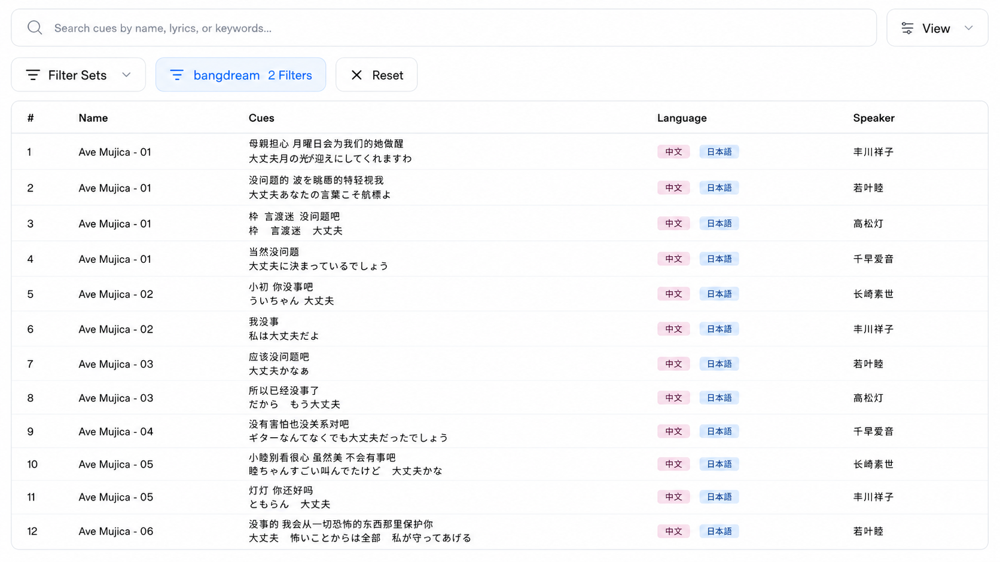
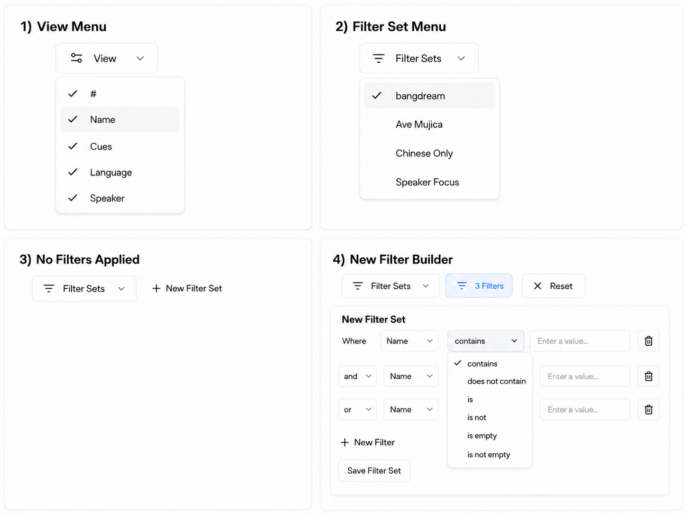

### 版本
main
### 需求描述
1. 在CueSeeker主界面顶栏，test shiori图标右侧新增一个test search ui图标，点击以后显示test searech ui界面。
2. 如参考图片中的Search界面1所示，它包含3个区域：搜索栏+View按钮，Filter Sets栏，表格。
3. 该界面使用假数据，主要用于对齐UI。
### 验收标准
1. 界面能够做到还原需求图的UI布局，样式等。
2. 代码规范，后续可维护，整体布局和样式可以复用给Library和Shiori界面。
3. 需要考虑后续的数据库模型：可视化数据库，自定义column及数据类型，编辑自定义数据，将可编辑数据库字段抽象为接口方便外部去修改。
4. 基本交互要可用，例如下拉选择框选择数据（如果会导致界面变化，也需要生效），Filter Set新增Filter，选择field或operator。

### 参考图片

